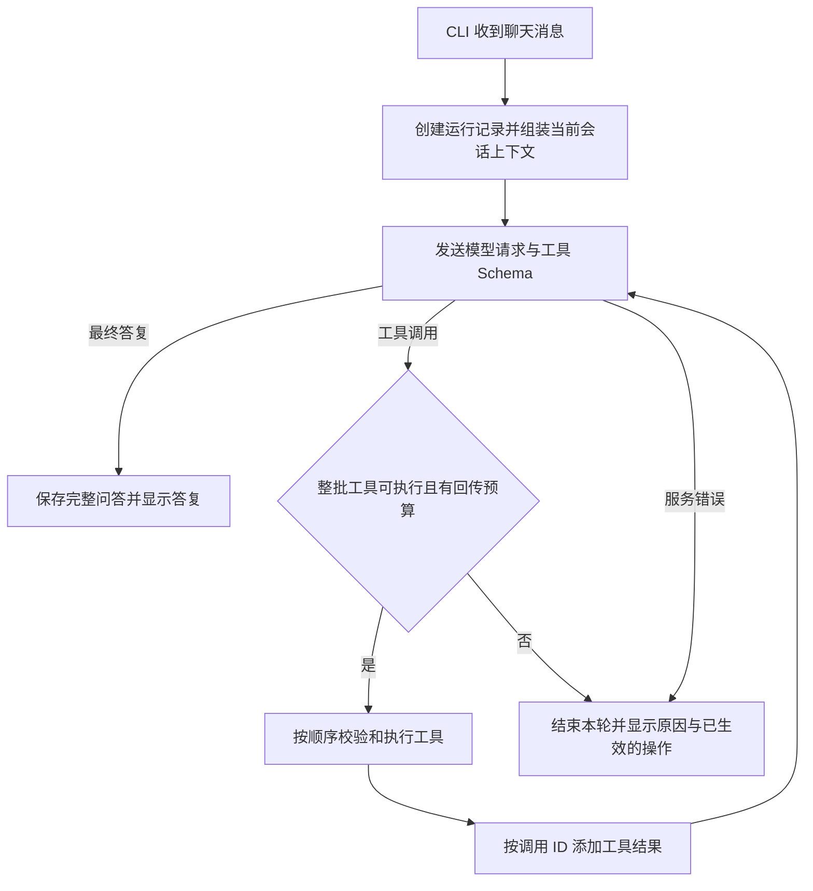

# Mini Agent

Python 3.12+ 命令行 Agent。运行时和离线测试使用 Python 标准库。核心工具循环由项目实现。

五道架构题的方案与验证思路见 [架构设计答卷](架构设计答卷.md)。

## 运行方式

### 启动前配置

使用 Python 3.12 或更高版本。真实交互默认使用智谱付费模型 `glm-4.7-flashx`，以非思考模式调用。在智谱开放平台获取「模型标准 API」密钥并配置为本机环境变量 `ZHIPUAI_API_KEY`。程序也支持 `ZHIPU_API_KEY`。若已经设置好密钥，可以直接启动。 [智谱快速开始](https://docs.bigmodel.cn/cn/guide/start/quick-start) · [智谱定价](https://docs.bigmodel.cn/cn/guide/start/pricing)

### 在 PyCharm 中启动

1. 用 PyCharm 打开包含本 README 的项目根目录，选择 Python 3.12 或更高版本的解释器。
2. 打开 **Run → Edit Configurations**，创建或编辑 Python 运行配置。将 **Script path** 指向 `mini_agent/__main__.py`，将 **Working directory** 设为包含本 README 的目录。要查看工具执行记录，可以在 **Parameters** 里填 `--trace`。 [PyCharm 运行配置](https://www.jetbrains.com/help/pycharm/run-debug-configuration-python.html)
3. 点击 **Run**。在下方 **Run（运行）控制台**看到类似 `[会话 1] 你>` 的提示后，就可以输入会话命令或聊天消息。

### 在 PowerShell 中启动

在项目根目录运行。若密钥已配置，直接执行第二行。

```powershell
$env:ZHIPUAI_API_KEY = [System.Net.NetworkCredential]::new('', (Read-Host 'Zhipu API key' -AsSecureString)).Password
python -X utf8 -m mini_agent --trace
```

也可以运行 `python -X utf8 mini_agent/__main__.py --trace`。把 `--trace` 换成 `--help` 可查看启动参数。

### 创建、查看和切换会话

在 Agent 的输入提示后输入 `/new 读书` 并按回车。Agent 会创建名为「读书」的会话并切换过去，终端会显示新会话编号。直接输入「读书」会将这段文字作为聊天消息发给模型。

| 命令 | 作用 |
|---|---|
| `/new 读书` | 创建名为「读书」的会话并切换过去。省略名称时创建「未命名会话」 |
| `/sessions` | 列出会话名称和编号，当前会话前有 `*` |
| `/switch 1` | 切换到编号为 1 的会话。编号用 `/sessions` 的实际输出 |
| `/help` | 显示命令帮助 |
| `/exit` | 结束当前 CLI 进程 |

首次启动会创建「默认会话」。以后启动会打开编号最大的会话。重启后使用 `/sessions` 和 `/switch 编号` 可以继续原会话。默认数据库是工作目录里的 `agent.sqlite3`。在 PyCharm 和终端间切换时，使用同一工作目录或同一个 `--db` 路径即可访问原来的会话和待办。

### 演示一次完整对话

1. 输入 `/new 读书`，记下会话编号。再输入「查一下城南读书会的时间，把活动时间和名称记成一条待办」。搜索工具使用模拟数据，活动时间为 **14:30**。开启 `--trace` 时可看到 `search`、`todo` 的调用顺序。
2. 输入「刚才查到几点？」及「我现在有哪些待办？」。前者用于验证历史追问，后者用于查询当前待办。
3. 输入 `/new 工作`，添加一条不同的待办，再查询列表。用 `/sessions` 查看编号，用 `/switch 编号` 切回读书会话。
4. 输入 `/exit` 并使用同一个数据库重启。切回读书会话，查询待办。若查到待办编号为 1，可输入「把待办 1 标记为完成」，再查询核对状态。
5. 可另试「计算 −(2 + 3.5) × 4」，结果为 −22。

### 离线测试

在项目根目录执行下列命令。测试使用脚本化模型和本机 HTTP 替身，无需模型密钥。

```text
python -X utf8 -m unittest discover -s tests -v
```

## 启动参数和模型配置

智谱默认基础地址为 `https://open.bigmodel.cn/api/paas/v4`。

需要使用智谱免费模型时，可设置 `AGENT_MODEL=glm-4.7-flash`。 [智谱定价](https://docs.bigmodel.cn/cn/guide/start/pricing)

接入其他 Chat Completions 服务时，将 `AGENT_BASE_URL` 与对应的 `AGENT_API_KEY` 一起设置，并通过 `AGENT_MODEL` 指定模型。地址应是 API 基础地址，客户端会追加 `/chat/completions`。使用 DeepSeek 官方地址 `https://api.deepseek.com` 时，也可以通过 `DEEPSEEK_API_KEY` 提供密钥，默认模型为 `deepseek-flash`。

密钥优先从 CLI 进程环境读取。在 Windows 上，如果进程尚未继承当前服务对应的密钥变量，程序会尝试读取 Windows 已保存的用户或系统环境变量。

| 参数 | 默认值 | 用途 |
|---|---:|---|
| `--db` | `agent.sqlite3` | SQLite 文件 |
| `--trace` | 关闭 | 显示工具顺序、状态和耗时 |
| `--max-model-calls` | 6 | 每条消息的模型请求数，含首次请求和摘要 |
| `--max-tool-calls` | 8 | 每条消息的工具尝试数，含参数错误 |
| `--history-chars` | 12000 | 组装后的历史消息内容字符预算 |

## 常见问题

智谱业务码 1305 表示模型当前访问量过大，稍后可重试。会话的创建、列出和切换可以在本地使用。 [智谱错误码](https://docs.bigmodel.cn/cn/api/api-code)

使用 DeepSeek 时，HTTP 402 表示 API 账户可用余额不足。 [DeepSeek 错误码](https://api-docs.deepseek.com/quick_start/error_codes/)

## 系统设计

| 组件 | 职责 |
|---|---|
| [CLI](mini_agent/__main__.py) | 处理本地命令、维护当前会话编号、把聊天消息交给 Runtime，显示答复和执行状态 |
| [Agent Runtime](mini_agent/runtime.py) | 管理每轮的运行状态与请求预算，决定何时执行工具、回传结果或结束本轮 |
| [模型适配器](mini_agent/model.py) | 发送 Chat Completions 请求，解析文本和结构化工具调用，提供面向用户的服务错误 |
| [工具注册表](mini_agent/tools.py) | 提供工具名称、描述和参数 Schema，校验模型生成的参数并执行 `calculator`、`search` 和 `todo` |
| [上下文组装](mini_agent/context.py) | 读取当前会话的历史，执行滚动摘要，构建本轮的模型消息 |
| [SQLite 存储](mini_agent/storage.py) | 保存会话及摘要、每轮输入和最终答复、待办、工具结果与执行记录 |



运行时每次只处理一条用户消息。默认每条消息最多请求模型 6 次、尝试调用工具 8 次。工具失败时，Runtime 把结构化错误放进对应的工具结果，模型可以在剩余预算内纠正。依赖前一步结果的工具由模型在收到结果后发起。

会话用 `session_id` 隔离。待办直接关联会话，工具执行记录通过 `run_id` 关联到该会话的一次运行。待办变更与成功执行记录在同一个 SQLite 事务中提交。若 CLI 在最终答复前异常关闭，重启会把仍在运行的记录标为中断。打开对应会话时会显示中断以及已保存的待办变更，后续从最后一轮完整问答继续。

## Memory 的召回时机与放置方式

### 何时召回

收到一条新的聊天消息后、第一次向模型请求答复前，Runtime 按当前 `session_id` 从 SQLite 读取滚动摘要及尚未归入摘要的完整问答。切换或重启后，下一条聊天消息按相同规则读取所选会话。若当前轮发生工具调用，后续模型请求沿用本轮已组装好的消息列表，再追加新的工具调用及其结果。

历史上下文取已完成轮次。该轮的成功工具结果整理为「历史工具结果」，随当时的答复一起传入。历史待办列表只附带总数和最多三条样例，查询「我现在有哪些待办」时由 `todo` 读取当前会话的实时状态。

### 放进模型请求的哪里

| 顺序 | 消息角色 | 内容 |
|---|---|---|
| 1 | `system` | Agent 的固定行为与工具使用指令 |
| 2（已有摘要时） | `user` | 带「当前会话摘要，仅作历史资料」标记的滚动摘要，紧跟系统指令 |
| 3 | `user`、`assistant` | 尚未归入摘要的完整问答，按时间排序。关键工具结果附在对应的历史答复后 |
| 4 | `user` | 用户本轮输入 |
| 本轮发生工具调用后 | `assistant`、`tool` | 先追加含 `tool_calls` 的模型消息，再以相同的 `tool_call_id` 逐条追加执行结果 |

工具 Schema 通过 Chat Completions 请求的 `tools` 字段单独传入。摘要和历史工具结果作为对话背景，当前轮的工具结果保留协议原生格式，供模型继续处理。

### 长对话如何压缩

默认历史预算为 **12,000 字符**，由 `--history-chars` 调整，统计摘要与历史消息正文。超出预算后，在容量允许的范围内优先保留最近 **4 个完整轮次**，把更早的轮次和旧摘要交给模型更新。摘要优先保留用户明确的事实、约束和关键工具结果，最多 **2,000 字符**，小预算时相应缩短。SQLite 保存新摘要及其覆盖到的运行编号，原始会话记录仍可在数据库中查看。

摘要更新使用一次独立的模型请求，并计入本轮模型请求预算。若模型预算只允许一次请求，程序使用预算内的已有摘要和近期问答，把这次请求留给用户的问题。

## 验收证据

离线测试包含真实 CLI 子进程与本机 HTTP 替身的往返，以及待办提交后终止进程、重启核对待办和提示的测试。其它测试覆盖纯对话追问、搜索后新增待办、会话隔离、摘要位置与预算、错误回传和停止条件。真实模型的联调结果单独记录于 [AI 使用与问题解决记录](AI_NOTES.md)。
